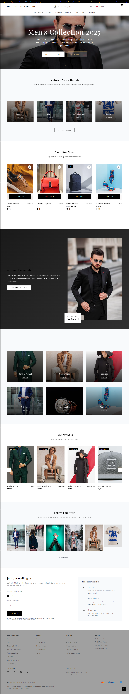
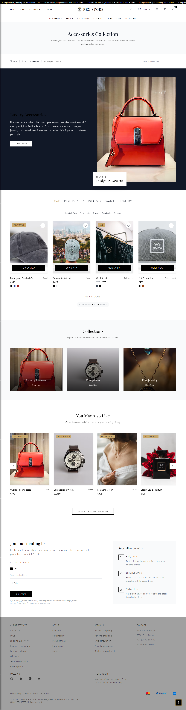
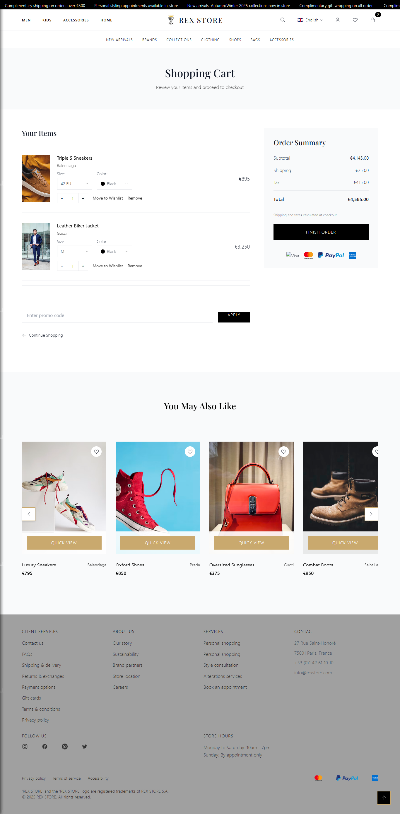
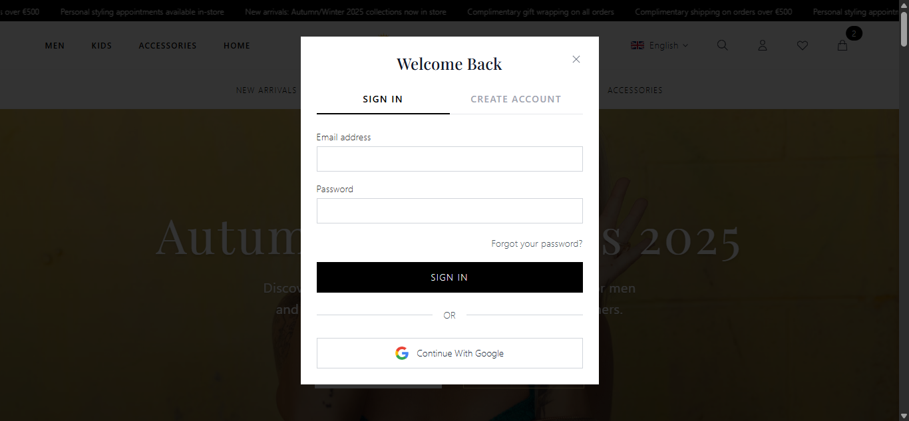

# REX STORE

A premium, responsive fashion e-commerce front-end template for men's and kids' collections. Built with semantic HTML5, Tailwind CSS (CDN) and vanilla JavaScript — no build step required.


## Preview

| Men's listing | Accessories |
| --- | --- |
|  |  |

| Shopping cart | Sign in |
| --- | --- |
|  |  |

## Features

- Responsive layout for mobile, tablet and desktop
- Announcement bar, mega-menu navigation and search overlay
- Shop listings by category: men, kids, accessories, bags, shoes, clothing, brands and new arrivals
- Product detail page with color, size and quantity selectors
- Cart and wishlist views, including empty states
- Account area: sign in / sign up modal, address book, orders and returns
- Informational pages: about, contact, FAQ, shipping, returns, payment options, privacy policy, terms of service and accessibility
- Scroll animations powered by AOS
- Accessible markup with ARIA roles and keyboard-friendly controls

## Project structure

```text
rex-store/
├── index.html              # Home page
├── assets/
│   └── videos/             # Background media
├── components/             # Reusable header, footer and after-header partials
├── css/                    # Global stylesheet + one stylesheet per page
├── js/                     # Page scripts, mirroring the HTML structure
├── pages/                  # Static content pages
├── shop/                   # Category and product pages
├── cart/                   # Cart and wishlist pages
└── user/                   # Account-related pages
```

## Getting started

Clone the repository and open `index.html` in a browser, or serve the folder locally:

```bash
git clone <repository-url>
cd rex-store
npx serve .
```

The template relies on CDN-hosted Tailwind CSS, AOS and Google Fonts, so an internet connection is required for styling and animations.

## Tech stack

- HTML5
- Tailwind CSS 2.2 (via CDN)
- Vanilla JavaScript (ES2015+)
- AOS 2.3 for scroll animations

## License

Released under the [MIT License](LICENSE).
